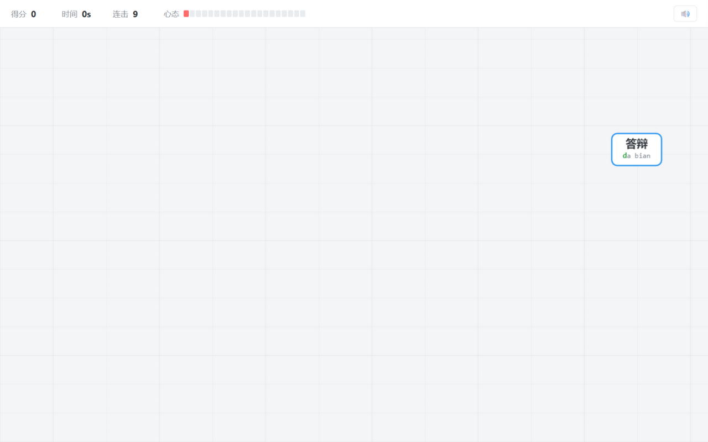
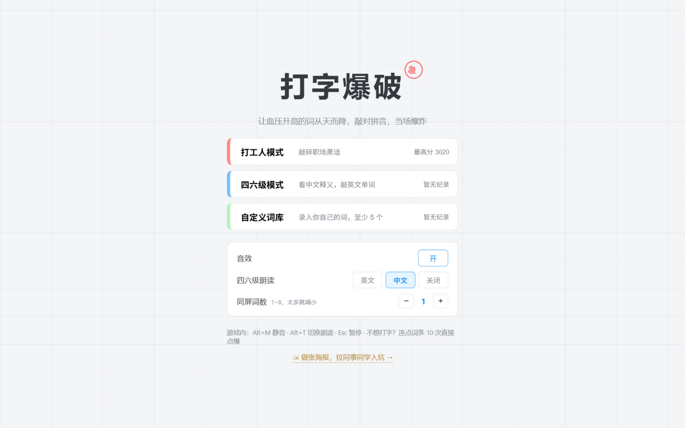
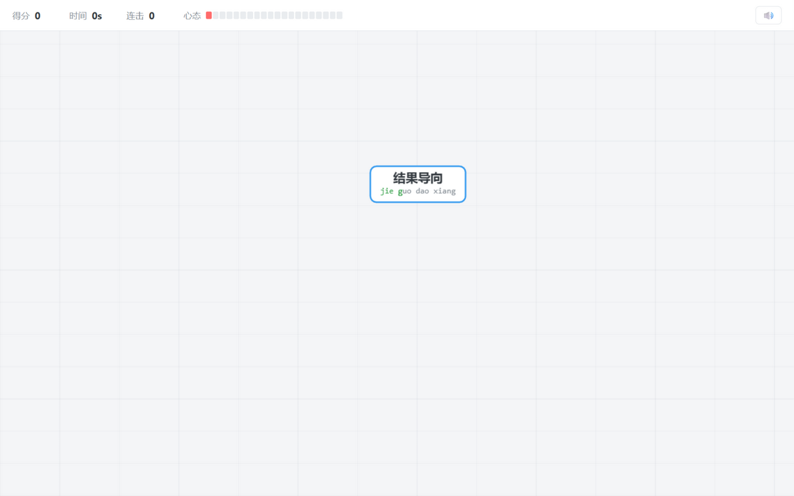

# 打字爆破 · Typing Blast

> 让人血压升高的词从天而降——敲对拼音/拼写，当场爆炸。
> 一个送给上班族和大学生的纯前端打字解压小游戏：零依赖、零后端、断网可玩。



## 游戏简介

- **打工人模式**：82→222 条职场黑话从天而降（对齐颗粒度、赋能、画大饼、996 的亲戚们……），敲拼音亲手敲碎它
- **四六级模式**：屏上显示中文释义，敲英文单词爆破，打爆还会自动朗读单词（英文/中文可切换），顺手背单词
- **自定义词库**：把老板语录、导师口头禅录进编辑器，生成专属词库（支持导入/导出分享）
- **心态成长制**：开局只有 1 格心态，每敲碎一个词 +1（上限 20），越玩越稳；达到 5/10/15/20 格触发「心态回稳 / 渐佳 / 大成 / 圆满」里程碑
- **连点爆破**：不想打字（或用手机玩）时，连点同一个词条 10 次也能点爆，计分与打字完全相同
- **彩蛋词**：打爆「下班」「放假」「发工资」「下课」，全屏烟花 + 1000 分
- **宣传海报**：自带二维码海报页（`poster.html`），扫码即玩、可直接打印贴工位

## 玩法与操作

| 操作 | 说明 |
|---|---|
| `a–z` 直接敲键盘 | 自动锁定目标（同首字母取最低的词），敲完整词爆炸 |
| 连点词条 10 次 | 不打字的备用玩法，手机触屏就玩这个 |
| `Backspace` | 解锁当前目标（进度保留） |
| `Esc` | 暂停 / 继续；切出窗口自动暂停 |
| `Alt + M` | 声音总开关（音效 + 朗读一键全关） |
| `Alt + T` | 切换单词朗读：英文 / 中文 / 关闭 |

其他规则：词落到底部心态 −1，心态归零游戏结束；无失误连击提升得分倍率（最高 ×3）；
combo 达到 10 / 25 / 50 有「手速惊人 / 键盘冒烟 / 同事侧目」特效；菜单可调同屏词数（1~8）。

## 截图

| 开始菜单 | 打字进行中 |
|---|---|
|  |  |

| 爆炸特效 | 宣传海报（poster.html） |
|---|---|
|  |  |

## 本地运行

**方式一（最简单）**：下载本项目，双击 `index.html` 即可玩（推荐 Chrome / Edge）。

**方式二（局域网分享，手机可玩）**：本机装了 [Node.js](https://nodejs.org) 的话：

```bash
node serve.js
```

启动后会打印本机局域网地址，手机连同一 WiFi 浏览器直接打开即可；
再开 `http://localhost:8123/poster.html` 可以拿到一张带二维码的宣传海报。

## 在线游玩（GitHub Pages）

部署后在这里放你的在线地址，例如：

**https://vickie29.github.io/typing-blast/**

部署方法见下方「发布到 GitHub Pages」章节，两分钟搞定。

## 技术栈

- 纯 vanilla HTML / CSS / JavaScript + Canvas 2D + WebAudio，**零依赖、零构建、零后端**
- 音效全部由 WebAudio 实时合成，单词朗读用浏览器内置 speechSynthesis，仓库内没有任何素材文件
- 二维码由内置的 `js/qr.js` 生成（版本 1-4、RS 纠错、8 掩码评估，同样零依赖）
- 最高分、设置、自定义词库均存 localStorage

## 项目结构

```
typing-blast/
├── index.html      # 游戏入口（菜单 / 游戏 / 结算 / 词库编辑器）
├── poster.html     # 宣传海报（手机样机 + 使用手册 + 二维码）
├── serve.js        # 可选：局域网分享服务器（node serve.js）
├── css/style.css   # 全部样式
├── js/
│   ├── words.js    # 内置词库（222+184 条）+ 本地存储
│   ├── audio.js    # WebAudio 音效合成 + 单词朗读
│   ├── fx.js       # 粒子爆炸 / 屏幕震动 / 飘字
│   ├── qr.js       # 零依赖二维码生成器
│   └── game.js     # 主循环 / 实体 / 输入锁定 / 状态机
└── docs/           # 截图 + 开发文档（五阶段规格与 AI 交接指令）
```

## 开发文档

本项目按五阶段规格开发，每阶段附自包含验收标准与 AI 交接指令，见 [docs/dev/WORKPLAN.md](docs/dev/WORKPLAN.md)。

## License

[MIT](LICENSE) © 2026
